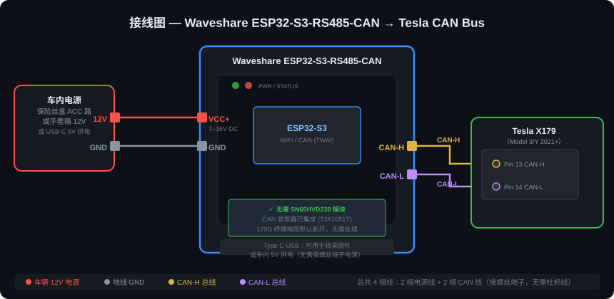

# Tesla FSD Controller — ESP32 Web 版

<p align="right"><a href="README_EN.md">English</a> | 中文</p>

> ## 🚫 重要公告：本项目对中国国内车辆已失效
>
> 自 **2026 年 3 月 31 日晚 9 时左右**，Tesla 向中国国内车辆远程下发了底层配置，从芯片层面禁用了 FSD 相关功能。**CAN 总线层面的修改已无法绕过此限制，本项目对中国国内车辆不再有效。**
>
> 注意：封禁期间 **FSD 账号授权不受影响**，已购买或订阅的 FSD 资格仍然保留，仅本 mod 失效。
>
> 海外车辆暂不受影响。本项目代码保留供学习、研究及海外用户使用。

---

基于 [ev-open-can-tools](https://github.com/ev-open-can-tools/ev-open-can-tools)（原 tesla-open-can-mod） 的 ESP32 + WiFi 控制面板版本。

烧录后，ESP32 会创建一个 WiFi 热点，手机连上就能用浏览器实时控制所有参数，**无需重新编程**。

---

## ⚡ 快速刷机（推荐，无需安装任何软件）

> 使用预编译固件，全程用浏览器完成，5 分钟搞定。

### 第一步：选择对应你的板子的固件

> 每个板子有两个固件文件，用途不同：
> - **`xxx_v1.4.25.bin`**（合并固件）→ 首次刷机用，通过 ESP Web Flasher 写入，地址 `0x0`
> - **`xxx_v1.4.25_ota.bin`**（OTA 固件）→ 后续无线升级用，通过控制面板「固件更新」上传；或让设备从 GitHub 在线自动拉取
>
> 完整最新资产见 [**releases 页面**](https://github.com/wjsall/tesla-fsd-controller/releases/latest)。以下为 **v1.4.25** 直链：

| 板子 / 变体 | 首次刷机 | OTA 升级 | 适用场景 |
|---|---|---|---|
| 标准 ESP32 + SN65HVD230 | [esp32_v1.4.25.bin](https://github.com/wjsall/tesla-fsd-controller/releases/download/v1.4.25/esp32_v1.4.25.bin) | [ota](https://github.com/wjsall/tesla-fsd-controller/releases/download/v1.4.25/esp32_v1.4.25_ota.bin) | 入门，5V USB 供电 |
| **Waveshare ESP32-S3-RS485-CAN** | [esp32s3_waveshare_v1.4.25.bin](https://github.com/wjsall/tesla-fsd-controller/releases/download/v1.4.25/esp32s3_waveshare_v1.4.25.bin) | [ota](https://github.com/wjsall/tesla-fsd-controller/releases/download/v1.4.25/esp32s3_waveshare_v1.4.25_ota.bin) | 车内永久安装，7–36V 宽压 |
| ESP32 Wi-Fi 桥接 | [esp32_wifi_v1.4.25.bin](https://github.com/wjsall/tesla-fsd-controller/releases/download/v1.4.25/esp32_wifi_v1.4.25.bin) | [ota](https://github.com/wjsall/tesla-fsd-controller/releases/download/v1.4.25/esp32_wifi_v1.4.25_ota.bin) | 给车机提供 Wi-Fi 上行 + DNS 过滤 |
| Waveshare ESP32-S3 Wi-Fi 桥接 | [esp32s3_waveshare_wifi_v1.4.25.bin](https://github.com/wjsall/tesla-fsd-controller/releases/download/v1.4.25/esp32s3_waveshare_wifi_v1.4.25.bin) | [ota](https://github.com/wjsall/tesla-fsd-controller/releases/download/v1.4.25/esp32s3_waveshare_wifi_v1.4.25_ota.bin) | 车内安装 + Wi-Fi 桥接 |

> **变体说明**：
> - **CAN 控制器**（`esp32` / `esp32s3-waveshare`）：接入车辆一路 CAN（X179 或 X652），完成 FSD 注入与遥测。
> - **Wi-Fi 桥接**（`esp32-wifi`）：ESP32 作为 STA 连上行 Wi-Fi，并以 AP 方式向车机输出带 DNS 过滤/域名拦截的网络。
> - **Waveshare ESP32-S3 Wi-Fi 桥接**（`esp32s3-waveshare-wifi`）：在 Wi-Fi 桥接基础上内置 FSD `/feature_configuration` 下发。该固件**不编译 CAN/TWAI、FSD 注入、DAS/灯光/空调/BMS/GPS/性能/服务模式**等旧模块，也不提供对应网页，只保留 Wi-Fi 热点/上游、DNS 过滤、FSD 下发、`/fsd` 看板、client-config、OTA 与日志。

### 第二步：刷入固件

1. 用 **Chrome 或 Edge** 打开 [ESP Web Flasher](https://esp.huhn.me/)
2. 板子通过 **Type-C** 连接电脑 → 点击「**Connect**」选择串口
3. 点「**Add File**」选择刚下载的固件，地址填 `0x0`
4. 点「**Program**」等待完成
5. 连接 WiFi 热点 `FSD-Controller`（密码 `12345678`），浏览器访问 `9.9.9.9`

> ⚠️ Safari 不支持 WebUSB，请使用 Chrome 或 Edge。
>
> **Waveshare ESP32-S3 进入烧录模式：** 按住板子上的 **BOOT 键不松**，按一下 **RST 键**后松开，再松开 BOOT 键，然后点击 Connect 并在弹出窗口中选择端口。烧录完成后板子会自动重启。

<p align="center">
  
  &nbsp;&nbsp;
  
</p>

---

## ⚠️ 重要声明（请先读完）

1. **仅限已购买 FSD 的车辆** — 本设备只是解锁 CAN 总线层面的限制，Tesla 服务器端必须有有效的 FSD 授权，否则不生效。
2. **风险自担** — CAN 总线直接连接车辆关键系统，发送错误报文可能导致不可预期的行为或电子部件损坏。本项目仅供学习和测试用途，作者不承担任何因使用本项目造成的车辆损坏、人身伤害或其他损失。
3. **保修失效** — 对车辆 CAN 总线进行改装可能导致 Tesla 官方保修失效，风险由使用者自行承担，作者对此不承担任何责任。
4. **遵守当地法律法规** — 在公共道路上使用辅助驾驶功能须符合你所在地区的交通法规。部分功能在特定地区可能存在法律限制，请在使用前自行了解并遵守当地相关法律，作者不对任何法律后果负责。
5. **交通事故免责** — 使用本设备期间发生的任何交通事故，包括但不限于车辆碰撞、财产损失、人身伤亡，责任由驾驶员本人承担，作者及项目贡献者不承担任何连带责任。驾驶时请始终保持专注，手握方向盘，随时准备接管车辆。
6. **不适用于公共道路测试** — 初次使用请在私有场地进行，确认功能正常后再上路。

---

## 所需材料

> 以下材料在淘宝/京东均可购买，搜索括号内的关键词即可。

### 方案一：标准 ESP32 开发板（入门推荐）

| 材料 | 说明 | 参考价 |
|------|------|--------|
| ESP32 开发板 | 搜「ESP32-DevKitC」或「ESP32 38Pin 开发板」 | ¥20–35 |
| SN65HVD230 模块 | 搜「SN65HVD230 CAN 模块 3.3V」，注意买 **3.3V** 版本 | ¥5–15 |
| 杜邦线（母对母）| 搜「杜邦线 母对母 20cm」，买一包备用 | ¥5 |
| USB 数据线 | Micro-USB 或 Type-C，取决于你的 ESP32 型号，用于烧录 | 通常自备 |

> **为什么选 ESP32？** 内置 WiFi 和原生 CAN（TWAI）控制器，无需额外芯片，成本最低。

### 方案二：Waveshare ESP32-S3-RS485-CAN（推荐车内永久安装）

| 材料 | 说明 | 参考价 |
|------|------|--------|
| **Waveshare ESP32-S3-RS485-CAN** | [淘宝购买链接](https://m.tb.cn/h.iGU3p56)，CAN 收发器已集成，导轨安装外壳 | [**¥99**](https://m.tb.cn/h.iGU3p56) |
| Type-C 数据线 | 烧录或 USB-C 车内供电时使用 | 通常自备 |

> **为什么选这个板？** 支持两种供电方式：**直接接车内 12V**（7–36V 宽压端子供电，无需降压模块）或 **USB-C 供电**。CAN 收发器已集成（TJA1051T），端子排螺丝接线（无需杜邦线），DIN 导轨外壳适合车内隐蔽安装。
>
> ⚠️ **120Ω 终端电阻默认已接通**，Tesla 总线两端已有终端电阻，必须把跳线帽从 `ON` 拔下改插到 `NC`，否则总线变 60Ω 会出现 `bus-off TEC=128` 错误。

---

## 接线方法

> 🚫 **禁止使用 OBD2 接口**：OBD2 诊断口连接的是诊断 CAN 总线，经过车辆网关 ECU 隔离，修改后的报文**永远无法到达 Autopilot 电脑**，设备将完全无效。必须直接接车辆内部 CAN 总线（X179 / X652 连接器）。
>
> ⚠️ **以下接线位置仅适用于 Model 3 / Model Y，已经过社区验证。Model S、Model X、Model 3 Highland、Model Y Juniper、Cybertruck 等其他车型的连接器位置不同，请勿照搬，必须自行查阅 Tesla 官方服务手册。**
>
> - **Model 3 / Model Y（2021 及以后）**：推荐接 <a href="https://service.tesla.com/docs/Model3/ElectricalReference/prog-233/connector/x179/" target="_blank" rel="noopener">X179 连接器</a>，Pin 13（CAN-H）/ Pin 14（CAN-L）
> - **Model 3（2020 及以前旧款）**：推荐接 <a href="https://service.tesla.com/docs/Model3/ElectricalReference/prog-187/connector/x652/" target="_blank" rel="noopener">X652 连接器</a>，Pin 1（CAN-H）/ Pin 2（CAN-L）
>
> 不确定时请先查阅 Tesla 服务手册，切勿盲目拆车接线。

---

### 方案一：标准 ESP32 + SN65HVD230

**Model 3 / Model Y 2021 及以后（X179）：**


**Model 3 2020 及以前（X652）：**


#### ESP32 ↔ SN65HVD230 模块

```
ESP32 GPIO 5  →  SN65HVD230 TX（有的板子标 CTX/D）
ESP32 GPIO 4  →  SN65HVD230 RX（有的板子标 CRX/R）
ESP32 3.3V    →  SN65HVD230 VCC
ESP32 GND     →  SN65HVD230 GND
```

#### SN65HVD230 ↔ 车辆 CAN 总线

```
SN65HVD230 CANH  →  车辆 CAN-H（通常为白色/棕色线）
SN65HVD230 CANL  →  车辆 CAN-L（通常为蓝色/绿色线）
```

---

### 方案二：Waveshare ESP32-S3-RS485-CAN（推荐车内永久安装）



接线极为简单，只需 4 根线，全部拧螺丝端子：

```
车辆 12V（保险丝盒 ACC 路）→  板子左侧端子 VCC+
车辆 GND                   →  板子左侧端子 GND
车辆 CAN-H（X179 Pin 13）  →  板子右侧端子 CAN H
车辆 CAN-L（X179 Pin 14）  →  板子右侧端子 CAN L
```

> - **无需** SN65HVD230 模块，CAN 收发器已集成（TJA1051T）
> - ⚠️ **必须处理 120Ω 终端电阻**：板上跳线默认短接在 `ON`，需拔下跳线帽改插到 `NC`。Tesla 总线两端已有 120Ω，不拔会并联成 60Ω → TEC 爆表 → 持续 bus-off
> - **无需** USB 常供电，可直接接车内 12V（ACC 路，随车熄火断电）

---

## 第一步：安装软件


### 1.1 安装 VS Code

1. 打开 [https://code.visualstudio.com](https://code.visualstudio.com)，点击下载并安装。
2. 安装完成后打开 VS Code。

### 1.2 安装 PlatformIO 插件

1. 点击 VS Code 左侧的「扩展」图标（四个方块的图标）。
2. 搜索 `PlatformIO IDE`，点击「安装」。
3. 安装完成后，VS Code 底部状态栏会出现一个小房子图标，表示 PlatformIO 已就绪（可能需要重启 VS Code）。

> **安装很慢？** PlatformIO 第一次启动会下载 ESP32 工具链，大约 200–500 MB，请耐心等待，保持网络畅通。

---

## 第二步：下载并打开项目

1. 点击本页面右上角的绿色「Code」按钮，选择「Download ZIP」。
2. 解压到任意文件夹，例如 `D:\tesla-fsd`。
3. 打开 VS Code，点击菜单「文件 → 打开文件夹」，选择刚才解压的文件夹。
4. VS Code 右下角可能会弹出「是否信任此文件夹」，点击「是，我信任作者」。

---

## 第三步：修改配置

> 烧录前**无需改任何代码**。WiFi 名称/密码和硬件版本均可在烧录后通过 Web 面板修改，设置自动保存。

### 3.1 修改 WiFi 热点名称和密码

**推荐方式（烧录后在 Web 面板修改）：**

1. 烧录完成后，用手机连上默认热点 `FSD-Controller`，密码 `12345678`。
2. 浏览器访问 `9.9.9.9`，在「**WiFi 设置**」卡片中填入新名称和新密码。
3. 点「保存并重启」，设备重启后用新名称/密码重连即可。

**也可以烧录前在代码中修改初始默认值：**

打开文件 `src/main.cpp`，找到第 20–21 行：

```cpp
static char apSSID[33] = "FSD-Controller";
static char apPass[64] = "12345678";
```

将引号内的内容改成你自己的名称和密码（密码至少 8 位），烧录后直接生效。

### 3.2 了解你的硬件版本

**不需要改代码。** 烧录完成后，在 Web 控制面板的「硬件版本」下拉菜单中选择即可，设置会自动保存，断电后也不丢失。

烧录前先确认你的版本，以便连上面板后能立刻选对：

| 车机显示 | 软件版本 | FSD 版本 | 控制面板选择 |
|----------|----------|----------|------|
| HW4.x | 2026.2.9.x 或更新 | V14 | `HW4` |
| HW4.x | 2026.8.x 或更旧 | V13 | `HW3` ⚠️ |
| HW3.x | 任意 | — | `HW3` |
| HW2.5 或更早 | 任意 | — | `LEGACY` |

> ⚠️ **HW4 硬件 + V13 固件必须选 `HW3`**：HW4 模式专为 FSD V14 设计，在 V13 固件上会导致功能不稳定（时好时坏）。在车机「控制 → 软件」中查看软件版本号来判断。

> **如何判断 HW2.5 还是 HW3？** 在车机「软件」→「额外车辆信息」中查看：有「全自动驾驶计算机」字样 → HW3；没有 → HW2.5，选 `LEGACY`。2019 年中后期起大多数车辆为 HW3，但同年也存在 HW2.5，需以车机实际显示为准。

---

## 第四步：烧录固件

### 连接 ESP32

用 USB 线将 ESP32 连接到电脑。

### 在 VS Code 中烧录

1. 点击 VS Code 底部状态栏左侧的「✓ Build」按钮先编译，确认没有错误。
2. 编译成功后，点击旁边的「→ Upload」按钮开始烧录。
3. 烧录成功后，终端会显示 `success`。

> **遇到「上传失败」？**
> - 检查 USB 线是否支持数据传输（有些线只能充电）。
> - 在 VS Code 底部状态栏点「端口」，确认已正确识别 ESP32 的 COM 口。
> - 部分 ESP32 开发板需要在上传时**按住 BOOT 按钮**，直到出现上传进度条后松开。

---

## 第五步：使用控制面板

### 5.1 连接 WiFi

1. 将 ESP32 上电（可以用充电宝供电，也可以直接从 USB 供电）。
2. 用手机打开 WiFi 设置，找到 `FSD-Controller`（或你修改的名字），输入密码连接。
3. 连接后，手机浏览器访问 `9.9.9.9`。

当前源码构建的 Waveshare ESP32-S3 Wi-Fi 桥接版使用 `http://9.9.9.9:10010/` 或 `http://fsd.local:10010/` 打开控制面板。访问旧首页会自动跳转到新端口。

### 5.2 控制面板说明

**基础设置**

| 设置项 | 说明 |
|--------|------|
| **FSD 开关** | 辅助驾驶改写总开关，关闭后从下一帧处理起停止 FSD 及 Legacy 限速/偏移改写；远光灯独立控制 |
| **硬件版本** | 对应你的车辆硬件，与第 3.2 步一致（可运行时切换，无需重新烧录）|
| **速度模式** | 控制 FSD 行驶激进程度，见下方速度模式说明 |
| **模式来源** | 「自动（拨杆）」= 用跟车距离拨杆控制速度模式；「手动」= 用上面的下拉菜单固定 |
| **限速提示音抑制** | 关闭 ISA 限速提示音（仅 HW4 有效）|
| **紧急车辆检测** | 启用紧急车辆靠近检测（仅 HW4 FSD V14 有效）|
| **强制激活** | 适用于「交通灯和停车标志控制」功能在车机 UI 中被隐藏的地区（中国、日本等）。这些地区的触发条件永远不满足，设备完全无反应。开启后强制绕过此判断，直接激活 FSD。 |
| **WiFi 设置** | 修改热点名称（SSID）和密码，点「保存并重启」后设备重启并以新名称/密码创建热点 |

LEGACY 的具体发帧条件、配置范围和验证方式见 [LEGACY CAN 发帧说明](docs/legacy-can.md)。

**HW3 速度偏移**

| 设置项 | 说明 |
|--------|------|
| **手动偏移** | 限速 × 百分比 的加速比例，例：限速 60 km/h + 偏移 25% → 实际目标 75 km/h |
| **智能速度偏移** | 按车速自动调整：限速越低偏移越大、限速越高偏移越小，共 5 档（阈值/百分比可自定义）|
| **≥80 km/h 让原车** | v1.4.17 新增，默认开启；限速 ≥80 km/h 时跳过 mux-2 覆盖，交还 Tesla 原生 EAP 拨杆偏移（+5/+10…）|

**在线 OTA**（v1.4.16+）

| 功能 | 说明 |
|------|------|
| **检查更新** | 从 GitHub Releases 拉取最新 tag，对比当前固件版本（需设备能访问 `api.github.com`）|
| **立即更新** | 直接下载匹配本板子的 `_ota.bin`，写入并重启 |
| **本地上传** | 也可手动选文件上传 `_ota.bin`（适用于离线环境）|

**扩展页面**

| 页面 | 路径 | 适用固件 | 说明 |
|------|------|----------|------|
| **统一管理页** | `/`、`/car` | Wi-Fi 桥接 | 大按钮：AP、上游 Wi-Fi、DNS 过滤、FSD 开关、OTA、日志 |
| **FSD 看板** | `/fsd` | Wi-Fi 桥接 | 命中/握手/时间线/载荷字段编辑（对齐 `fsd_panel.py`）|
| **车机客户端配置** | `/client-config` | Wi-Fi 桥接 | client-config JSON 发布/回滚/确认（端口 10010）|
| **日志** | `/api/log` | 全部 | RAM 诊断日志（约 80 条）；`/api/log/download` 下载 SPIFFS 持久日志 |
| **车机 UI / 仪表盘 / 性能测试 / 服务模式** | `/dash`、`/perf`、`/service` | 仅 CAN 版 | Wi-Fi 桥接精简固件已移除这些页面与接口 |

### Wi-Fi 桥接精简构建（`FSD_MOCK_ONLY`）

`esp32s3-waveshare-wifi` 在 `platformio.ini` 中定义 `-DFSD_MOCK_ONLY`，从链接层面移除旧 CAN/FSD 注入栈：

- `main.cpp` 不再包含 `handlers.h`、`fsd_config.h`、`mod_fsd.h`、`mod_bms.h`、遥测/灯光/空调/性能/服务模式等头文件，也不创建 CAN 任务或注册 `/dash`、`/perf`、`/service`、`/api/set`、`/api/perf`、`/api/diag/*`。
- `compress_html.py` 只为该 env 打包 `web_ui_manage.h` + `web_ui_fsd.h`，不再把手机主面板、车机面板、仪表盘、性能页和服务模式页写进固件。
- 与清理前相比，实测 Flash 约减少 142 KB、静态 RAM 约减少 3.5 KB；运行时还少一个 8 KB 的 CAN 任务栈。`esp32` / `esp32s3-waveshare` 等 CAN 版本行为不变。

### 自有客户端 HTTPS 配置发布

ESP32-S3 Wi-Fi 桥接固件在管理端口 `http://9.9.9.9:10010/client-config` 提供自有客户端 JSON 配置页面/API。**`443` 固定留给 FSD 下发**（`/feature_configuration` 回包和其余路径反代），不再注册 client-config；设备管理面板在 `http://9.9.9.9:10010/`。client-config 与 443 共用同一组管理/客户端令牌（首次启动生成并保存在 NVS），但 HTTP API 不再需要单独安装证书。

1. 连接设备的 USB 串口（115200），发送 `client-config` 并附换行。会返回 443 FSD 使用的 eMudhra 信任包（emSign ECC Root + EM OV TLS CA - G3C + cross-sign）以及管理令牌、客户端令牌。PEM 仅用于信任 443 的 FSD 证书；client-config 页面不再需要它。
2. 连接设备热点，打开 `http://9.9.9.9:10010/client-config`，用管理令牌读取、发布或回滚配置。JSON 对象上限为 1024 字节（紧凑编码）。
3. 连到设备热点的客户端可用下面的命令拉取配置并原子写入本地文件。脚本提示输入客户端令牌，写入成功后回报应用版本。管理页点「读取」可查看最新确认。

   ```sh
   python3 tools/client-config/pull.py --output client-settings.json
   # 默认连接 http://9.9.9.9:10010；如需改地址/端口：--host 9.9.9.9 --port 10010
   ```

客户端凭据可读取及确认配置。管理凭据可读取、发布和回滚。设备保留当前版本和上一份配置，回滚时发布新版本。确认状态记录持有客户端令牌的一方最近一次成功确认的版本。

HTTPS 配置服务使用本地存储，可在上游断网时工作。此版本的热点对 IPv4 外出转发默认拒绝。只有按现有黑白名单规则获准、且经 ESP32 DNS 的 A 查询返回的 IPv4 地址才会临时放行，授权有效期为 60 秒。清空白名单、关闭 DNS 过滤、修改规则或上游断线会撤销授权。IPv6 转发关闭。开放热点给其他用户前，应先通过控制面板设置管理 PIN，保护规则编辑。

转发层按目的 IP 放行，共用同一地址的服务无法在这一层按域名区分。此策略覆盖经 ESP32 热点转发的流量，设备自身的 OTA 和诊断功能使用独立网络路径。

### FSD 下发（feature_configuration，与 Windows 对齐）

`esp32s3-waveshare-wifi` 固件内置了 TeslaDG Windows 版的核心下发链路，默认开启，逻辑与 `C:\fsd-mitm` 一致：

1. **DNS 劫持**：AP 的 DNS 把 `api-prd.vn.cloud.tesla.cn` 解析为 ESP32 自己的 AP 地址 `9.9.9.9`（对应 Windows `dns_sink.py --redirect api-prd.vn.cloud.tesla.cn`）。A 查询返回 AP IP，AAAA 和其他类型返回空答案。域名按精确匹配处理，多个域名用空格分隔；与 Windows `--redirect` 集合一致，不支持通配符。
2. **443 回包**：车机请求任意路径中的 `/feature_configuration`（可带 VIN 前缀、结尾 `/`、`?` 或 `#`）时，返回：
   - `200 OK`，`Content-Type: application/json`
   - `X-Checksum: md5(compact body)`
   - `Cache-Control: no-store`
   - body 为当前下发载荷的 compact JSON
3. **其他路径**：与 Windows mitmdump reverse 模式一样转发到真实 `api-prd.vn.cloud.tesla.cn`，不会在 ESP32 本地返回 404。

ESP32 默认载荷在 Windows `payload.json` 的 20 字段基础上追加了 `enable_eu_fsd_behavior:false` 和 `autoshift_dr:true`（`autoshift_dr` 固定最后），共 22 字段 / 653 字节 / md5 `d216ba9d001cfff321dfb6e596f61d64`。原始 Windows 602B 仍保留为独立预设，可随时回滚：

> 注：`fsd_mock.py` 内置的 `DEFAULT_PAYLOAD` 与 `payload-282b.json` 字段相同、键顺序不同（md5 为 `104ccde7d817ab00667f2d98326259ec`）；Windows 启动脚本始终优先加载 `payload.json`，所以这里以 602 字节文件和看板认定的 282B 原版为准。

| 预设 | 字节 | md5 | 来源 |
|---|---:|---|---|
| ESP32 默认 22 字段 | 653 | `d216ba9d001cfff321dfb6e596f61d64` | Windows 20 字段 + `enable_eu_fsd_behavior:false` + `autoshift_dr:true` |
| Windows 20 字段 | 602 | `241cb01b81a2b9c8b9f389a471bcbc94` | `payload.json`（未修改）|
| 16 字段 | 476 | `b61035d9dea38e737fbf8195ccb39f2c` | `payload-16f.json` |
| 官方 282B | 282 | `c212a75ca858750ac302093c138991f2` | `payload-282b.json`（看板认定原版）|

**端口分工**：管理面板和 client-config 都固定在 `http://9.9.9.9:10010/`（页面 `/client-config`，API `/api/client-config`）；`443` 只跑 FSD 下发（TLS catch-all，命中 `/feature_configuration` 回包，其余路径反代），不注册 client-config 页面。这样只保留一个 HTTPS 服务器，避免第二个 TLS 任务/套接字占用约 40 KB 堆内存。`443` 同时只保留 1 个车机 TLS socket；上游未连接时，其余路径立即返回 `502 {"error":"upstream_unavailable"}` 并关闭连接，不再创建上游 TLS 上下文，避免“车机 TLS + 上游 TLS + 多 socket”耗尽堆内存导致 AP 掉线。关闭上游后 AP 会自动回到固定信道 1。

**证书**：443 服务使用与 Windows `--emudhra` **完全相同**的证书材料，而不是 mitmproxy 自签 CA。叶子有效期与 app 内 `certs2/mitmproxy-ca-cert.pem` 一致（2026-11-07 22:54:45 GMT → 2036-11-04 22:54:45 GMT）。`include/fsd_tls_identity.h` 里的 3 张中间/根证书与 mitmproxy 12.3.1 `EMUDHRA_CHAIN_PEM` **逐字节一致**（`EM OV TLS CA - G3C` → `emSign Root TLS CA - G3` → `emSign ECC Root CA - G3`，并带 AAA Certificate Services 交叉签名）。叶子按 mitmproxy 的 `dummy_cert()` 规则生成：同一把失陷 `EM OV TLS CA - G3C` 私钥/公钥、`CN=api-prd.vn.cloud.tesla.cn, O=Tesla Inc.`、Tesla 上游 SAN、EKU/AKI，有效期 2026-11-07 → 2036-11-04（与 app 内 certs2 证书相同）。额外 SAN 保留 `mothership.vn.teslamotors.com`、`fsd.local`、`9.9.9.9`、`127.0.0.1` 供本机面板/client-config 使用。车机通常已信任 emSign 根，所以**不需要安装证书**；如果车机不信任 emSign，把串口导出的 `EM OV TLS CA - G3C` 中间 CA 装进车机信任库即可。叶子私钥随源码公开（eMudhra 中间 CA 已失陷），仅适用于实验环境。

**回复 / 观察模式**：与 Windows `mode.json` 一致。`reply` 直接回包；`observe` 只记录并转发到上游，不返回 ESP32 载荷。可在面板 DNS 页的「FSD 下发」卡片切换。劫持判断排在 DNS 黑白名单之前，因此即使白名单没有 `api-prd`、或 DNS 过滤关闭，只要 FSD 下发开启，该域名仍会被劫持。

**配置与查看**：

- 面板：`http://9.9.9.9:10010/`（或 `/car`）的「FSD 下发」卡片。可启停劫持、切换模式、编辑载荷、加载 Windows 预设。该精简固件不再包含旧 CAN 仪表/注入页面。
- **PC 风格看板**：`http://9.9.9.9:10010/fsd`，对齐 `TeslaDG/app/web/fsd_panel.py`：拦截次数、最后拦截、VIN、当前载荷、车机状态、最后下发、请求总数、DNS 重定向、握手表、下发时间线、车机最近请求、接口分布、配置变更、当前回包载荷。
- **字段编辑**：同一页面底部可添加/删除参数、修改值、恢复默认（22 字段 / 653B，含 `enable_eu_fsd_behavior:false`、`autoshift_dr:true` 最后）、加载 Windows 602B / 16f / 282B，或切换原始 JSON。字段旁有中文说明，保存后写入 SPIFFS，重启保持。
- 状态：`/api/wifi-bridge/status` 中的 `fsdMock` 字段包含 `enabled`、`mode`、`host`、`bytes`、`md5`、`fields`、`hits`、`observes`、`flows`、`dnsRedirects`、握手摘要、最后一条 FSD 回包和最近 3 条 FSD 命中（`FLOW` 只进 JSONL 日志，不占“最近命中”/“当前回包载荷”）。面板的“当前回包载荷”按 Windows `fsd_panel.py` 的方式显示格式化 JSON；非 FSD 透传的 400/200 不会覆盖它。
- 读取载荷：`GET /api/fsd-mock/payload`（返回当前 compact JSON）。
- 写入载荷：`POST /api/fsd-mock/payload`（body 为 JSON 对象，上限 2048 字节）。
- 其余动作：`GET /api/fsd-mock/set?enabled=1&mode=reply&host=...&preset=default|16f|282b`、`POST /api/fsd-mock/hits-clear`、`POST /api/fsd-mock/handshakes-clear`、`GET /api/fsd-mock/hits`、`GET /api/fsd-mock/handshakes`（RAM JSONL 导出）。
- 串口恢复（115200，附换行）：`fsd-payload` 打印当前 compact JSON；`fsd-default` / `fsd-16f` / `fsd-282b` 直接加载对应预设并写入 SPIFFS。`net-test` 检查 upstream DNS + TCP 到 `api-prd`，`wifi-diag` 打印载荷/命中/握手计数、堆、PSRAM 和 SPIFFS 余量。
- 串口 Wi-Fi 恢复：`wifi-list` 列出已保存上游；`wifi-add <ssid> <password>` 添加/更新上游并立即连接；`wifi-del <ssid>` 删除；`wifi-up` 启用上游；`wifi-ap-only` 关闭上游并强制 AP 回信道 1。NVS 被清空后可用这组命令重新配置，无需先连上 AP。
- **FSD 日志不写 SPIFFS**：命中/握手只保留在 RAM 环形缓冲区（命中 8 条、握手 6 条），重启即清空；这样可以避免日志占满闪存导致 payload 无法保存，也符合“后台可看、不落盘”的要求。

> 非 FSD 反代按 Windows 的 `--set ssl_insecure=true` 关闭上游证书校验（Tesla `api-prd` 使用私有 CA，公共 CA bundle 无法验证）。如果 Tesla 端点要求 mTLS 客户端证书，默认 mitmproxy 不会转发车机证书，会得到 Tesla 的真实 `400 No required SSL certificate was sent`；ESP32 现在同样返回这个真实响应，而不是本地 502。需要 mTLS 的端点必须在 PC/网关侧配置客户端证书，ESP32 无法替车机出示其私钥。

> 与 Windows 的差异：ESP32 的 observe/透传转发常用 Tesla 请求头（Authorization、Content-Type、Accept、Accept-Encoding、User-Agent、Cookie、条件请求等）并回传 Content-Encoding/Location/Set-Cookie 等响应头，请求体上限 4 KB；mitmproxy 没有这些限制。日志预览的 `req_head` 保留前 64 字节（Windows 为 256 字节）以控制 RAM。ESP-IDF 的 `esp_https_server` 只实现 HTTP/1.1，不提供 HTTP/2；客户端未协商到 h2 时会回退到 HTTP/1.1。日常 FSD 配置下发不受影响。

### Wi-Fi 桥接 DNS 白名单 / 黑名单安全说明

> 本节只适用于 `esp32_wifi` / `esp32s3_waveshare_wifi` 这类 **Wi-Fi 桥接版固件**。它提供的是本地网络层面的风险控制，不是 Tesla 授权绕过，也不能保证账号、车辆或云端风控绝对安全。
> 当前源码构建的 Waveshare ESP32-S3 Wi-Fi 桥接版使用上一节的默认拒绝转发策略。以下放行默认、IP 开关和缓存说明适用于传统桥接策略。

**工作边界**

- 车机连接 ESP32 创建的 AP；ESP32 再作为 STA 连接手机热点、家用路由或其他上游 Wi-Fi。
- 桥接版会让 AP 的 DHCP 把 ESP32 自己的 AP 地址作为 DNS 下发给车机，并在 UDP `53` 端口运行过滤 DNS。
- 只有经过这个 ESP32 AP、且 DNS 查询先到达 ESP32 的流量，才能被域名白名单 / 黑名单判断。
- 当前固件只配置 IPv4 AP 地址、IPv4 DHCP DNS 和 IPv4 NAPT；不会主动给车机分配 IPv6 地址，也没有启用 IPv6 转发。
- 首次初始化会默认启用 Tesla 推荐规则：常用必要域名放在白名单，`tesla.cn`、`tesla.com`、`teslamotors.com`、`tesla.services` 放在黑名单。用户后续修改后，设备会尊重用户配置。
- “IP 层拦截”是单独开关，默认关闭；开启后才会在 IPv4 转发层按黑名单解析出的 IP 丢包。

**白名单和黑名单的规则语义**

- 规则按空格、换行、逗号或分号分隔。
- 域名会先做规范化：去掉首尾空白、转小写、去掉末尾的点。
- 规则支持精确匹配和子域名后缀匹配。例如 `tesla.cn` 会匹配 `tesla.cn` 和 `a.b.tesla.cn`，但不会匹配 `not-tesla.cn`。
- 黑白名单均支持 `*.qq.com` 写法：匹配 `music.qq.com`、`a.b.qq.com` 等任意层级子域名，**不匹配 `qq.com` 本身**，也不匹配 `fakeqq.com`。要同时覆盖主域和所有子域，继续使用 `qq.com`，或填写 `qq.com *.qq.com`。
- 白名单 = 放行；黑名单 = 屏蔽。
- 白名单和黑名单同时命中时，**更长、更具体的域名后缀优先**（不计 `*.` 前缀）；长度相同时白名单优先。例如白名单 `*.qq.com` 不会覆盖黑名单 `a.qq.com`。
- 如果白名单非空，且某个域名没有命中任何白名单规则，则默认不放行。这是“默认拒绝”模式，安全性更高，但可能影响部分在线功能。
- 如果白名单为空，且域名没有命中黑名单，则默认放行。这是“只黑名单”模式，兼容性更好，但安全性较弱。

推荐组合是“宽黑名单 + 精确白名单”：例如把 `tesla.cn` 放入黑名单，同时只把 `connman.vn.cloud.tesla.cn`、`nav-prd-maps.tesla.cn` 等确实需要的子域放入白名单。这样必要服务可用，未列出的同根域名会被拦截。

**DNS 层屏蔽原理**

1. 车机向 ESP32 发起普通 DNS 查询。
2. ESP32 解析 DNS 包中的域名和查询类型。
3. 如果规则判定为放行，ESP32 把查询转发给当前上游 Wi-Fi 提供的 DNS 服务器，并把响应原样返回给车机。
4. 如果规则判定为屏蔽，ESP32 会记录拦截统计：
   - `A` 记录返回 `0.0.0.0`；
   - `AAAA` 或其他类型返回“成功但无答案”，减少客户端改用备用 DNS 的概率。
5. 屏蔽命中的域名还会尝试解析一次，把解析出的 IPv4 地址加入 IP 拦截缓存，供可选的转发层拦截使用。

**IP 层拦截原理**

开启“IP 层拦截”后，固件会周期性解析黑名单中的域名，并维护一个最多 256 条的 IPv4 缓存。缓存条目默认保留 1 小时，黑名单会增量刷新，完整刷新间隔约 5 分钟。

`*.qq.com` 这类通配规则不会被当作主机名预解析，也不会自动枚举全部子域名；当具体子域的 DNS 查询被拦截时，才会尝试解析该子域并加入 IP 缓存。

ESP32 的 lwIP 转发钩子会检查每个准备从 AP 转发到上游的 IPv4 包：如果目的 IP 命中缓存，就直接丢弃；否则交给默认 NAT 转发。这个机制可以补一部分“客户端已经拿到 IP 后继续直连”的情况，但它不是完整防火墙，不能覆盖所有 CDN、动态 IP、DoH 或硬编码 IP 场景。

**安全性对比**

| 模式 | 安全性 | 兼容性 | 适用场景 |
|------|--------|--------|----------|
| 只用黑名单 | 较弱：未知新域名默认放行 | 最好 | 只想屏蔽少量明确遥测/触发域名 |
| 白名单非空 | 较强：未知域名默认拒绝 | 可能破坏部分在线功能 | 希望尽量减少车机与未知云端通信 |
| 白名单 + 宽黑名单 | 推荐：必要子域放行，父域默认拦截 | 取决于白名单完整度 | 当前 Tesla 推荐预设的设计思路 |
| DNS + IP 层拦截 | 比单纯 DNS 更强 | 可能影响流媒体/地图/应用稳定性 | 高风险场景，愿意牺牲一些流畅性 |

不要把它理解成“绝对隔离”。它的安全性依赖三个前提：车机确实走 ESP32 AP；车机使用 ESP32 下发的普通 DNS；被拦截目标能通过域名或已缓存 IPv4 识别。

**如果上游强制 DoH，是否仍然安全？**

结论：**不一定，要看 DoH 发生在哪一跳。**

- 如果只是“上游路由器 / 热点自己把收到的普通 DNS 再用 DoH 转发出去”，通常仍然安全。因为车机的 DNS 请求已经先经过 ESP32，ESP32 能看到域名并完成白名单 / 黑名单判断，上游用 UDP DNS 还是 DoH 只是后续解析方式不同。
- 如果是“车机、浏览器、系统 Private DNS、App 或上游策略让客户端直接向外部 DoH/DoT 服务器查询”，则不安全。DoH 走 HTTPS `443`，DoT 走 TLS `853`，域名内容被加密，ESP32 当前固件不会做 TLS 中间人、不会解析 HTTPS 内容，也不会按 SNI 做通用防火墙判断。
- IP 层拦截只能缓解一小部分情况：如果黑名单域名已经被 ESP32 解析进缓存，后续直连这些 IPv4 会被丢弃。但 DoH 能解析出 ESP32 从未见过的目标 IP，或者使用 CDN / 动态 IP，仍可能绕过。

因此，如果你面对的是客户端侧强制 DoH/DoT，仅靠本固件的 DNS 白名单 / 黑名单不能视为安全。更稳妥的做法是：关闭车机或测试设备上的 Private DNS / DoH；在上游路由器阻断常见 DoH/DoT 解析器和 `853` 端口；必要时在上游防火墙做真正的出口白名单。当前 ESP32 固件本身不提供“只允许白名单 IP 出口”的完整防火墙能力。

### 5.3 速度模式对照表

| 设置值 | HW3 显示 | HW4 显示 |
|--------|---------|---------|
| 保守 | ❄️ Chill | ❄️ Chill |
| 默认 | 🟢 Normal | 🟢 Normal |
| 适中 | ⚡ Hurry | ⚡ Hurry |
| 激进 | — | 🔥 Max（最快）|
| 最大 | — | 🐢 Sloth（最慢）|

> 跟车距离拨杆和速度模式的关系：拨杆数字越小 = 越激进；拨杆数字越大 = 越保守。

### 5.4 状态监控

控制面板下方的状态卡片实时显示：
- **已修改**：本次启动共修改了多少个 CAN 帧（大于 0 说明工作正常）
- **已接收**：收到的 CAN 帧总数
- **错误**：CAN 总线错误计数（正常应为 0）
- **运行时间**：ESP32 已运行时长
- **CAN 总线**：显示「正常」说明已成功接入车辆 CAN 总线
- **FSD 已触发**：显示「是」说明 FSD 已被激活

---

## 第六步：无线更新固件（OTA）

修改代码后不需要再插 USB，有**两种方式**更新：

### 方式一：在线自动拉取（推荐，v1.4.16+）

适合使用官方发布版本的普通用户。需要设备能访问互联网（常见做法是通过手机热点或家里 Wi-Fi 作为 STA 连出）。

1. 在控制面板「**在线更新 (从 GitHub)**」卡片中点「**检查更新**」。
2. 设备查询 `api.github.com/repos/wjsall/tesla-fsd-controller/releases/latest`，显示最新版本号。
3. 如有新版，点「**立即更新**」。设备自动下载对应 env 的 `_ota.bin`、校验、写入并重启。
4. 版本比对逻辑：仅当远端 tag 严格大于当前固件版本时允许升级；资产按 `<env>_v<ver>_ota.bin` 命名匹配本板子。

### 方式二：本地上传（开发者 / 离线场景）

1. 在 VS Code 中修改代码并编译（点「Build」）。
2. 编译完成后，项目根目录会自动生成匹配该 env 的 **`<env>_v<ver>_ota.bin`**（例：`esp32s3_waveshare_v1.4.25_ota.bin`）。
3. 在控制面板底部「**本地上传**」区域点「选择文件」，选刚才那个 **`_ota.bin`** 文件。
4. 点「上传固件」，等待进度条完成，设备会自动重启。

> ⚠️ **OTA 必须使用 `_ota.bin` 文件**，不能用合并固件（`<env>_v<ver>.bin`）。合并固件包含 bootloader，OTA 会报 "Wrong Magic Byte" 错误。
>
> ⚠️ **切换 env 不能走 OTA**：从 esp32 切到 esp32s3_waveshare（或单 CAN 切双 CAN、Wi-Fi 变体）分区布局不同，必须用 USB Web Flasher 重新烧合并固件。
>
> ⚠️ **合并固件会覆盖 NVS**：`<env>_v<ver>.bin` 从 `0x0` 写入，包含 bootloader、分区表和 app 之间的填充区（`0x9000` 起的 NVS）。首次刷机没问题；日常升级请优先用 OTA `_ota.bin`，或用 `esptool write_flash 0x10000 .pio/build/<env>/firmware.bin` 只写 app，以保留 Wi-Fi/PIN/上游配置。

---

## 常见问题

**Q：连上 WiFi 后浏览器打不开 9.9.9.9？**
> 部分手机在连接无网络的 WiFi 时会自动断开，在手机 WiFi 设置中找到该热点，关闭「自动切换更优网络」或「智能 WiFi」选项。

**Q：CAN 总线显示「异常」？**
> 检查 CANH/CANL 接线是否正确，确认车辆已上电（至少开到「待机」状态）。CAN 总线只有在车辆通电后才有信号。

**Q：FSD 已触发显示「否」？**
> 确认车机「控制 → 自动辅助驾驶」中已开启「交通灯和停车标志控制」，这是 FSD 触发的条件。

**Q：需要拆掉 CAN 模块上的 120Ω 终端电阻吗？**
> Tesla CAN 总线两端已有内置终端电阻，模块上如果再叠加一个会并联成 60Ω，导致信号失真、TEC 爆表持续 bus-off（`bus-off TEC=128 REC=0` 错误就是这症状），**必须确保模块的 120Ω 电阻断开**。
> - **Waveshare ESP32-S3-RS485-CAN**：⚠️ 板上 120Ω 跳线**默认短接在 `ON`**，收到板子后找到 CAN 端子附近的 **120R** 跳线，把跳线帽**拔下改插到 `NC`** 位置（仅保留在 NC 一侧，或完全拔掉）。这是最容易被漏掉的一步。
> - **SN65HVD230 模块**：芯片本身不带终端电阻，但部分厂商的模块会在 PCB 上额外加一颗，通过跳线或焊桥控制。收到模块后翻到背面检查 **120R** 标注旁的跳线帽或焊桥，如果已连通需要断开（拔掉跳线帽，或用刀片划断焊桥）。
> - **MCP2515 蓝色模块**：**必须拆掉**板上的 R1/R2 电阻或切断 J1 跳线。

**Q：「已修改」帧数一直是 0，设备没有反应？（中国、日本等地区）**
> 开启控制面板中的「**强制激活**」。中国、日本等地区的车机 UI 中没有「交通灯和停车标志控制」选项，该功能被区域限制隐藏，导致设备的触发条件（`UI_fsdStopsControlEnabled` bit）永远为 0，mod 永远不触发。开启强制激活后会绕过此判断，直接激活 FSD。

**Q：设备工作了但 FSD 还是用不了？**
> 检查 Tesla 账号是否有有效的 FSD 授权（购买或订阅）。设备只处理 CAN 层面，不能绕过 Tesla 服务器的授权验证。

**Q：速度模式设置后没有效果？**
> 确认「模式来源」设置为「手动」，否则会被拨杆位置覆盖。

**Q：烧录时报错「A fatal error occurred: Failed to connect to ESP32」？**
> 烧录时按住开发板上的「BOOT」按钮，看到上传进度条出现后松开。

---

## 🧪 帮助建立兼容矩阵

> **Model X Raven 维护模式开发入口**：手机主页「车辆信息」或车机「设置 → 操作」进入 `/service`。可按公开旧款 S/X 定义观察实时挡位和车速，显示无信号、超时、格式或校验问题，并提供手动操作指引与官方 Toolbox 例程链接。**自动进入／退出尚未实现**；2019 Raven / 2026.2 的执行协议与观察值仍待实车验证。实现边界、资料来源与验收要求见 [开发说明](docs/raven-service-mode.md)。

不同 Tesla 固件 / HW 芯片 / 协议（V13/V14）/ 地区组合下激活成功率差很大，社区还在收集样本。**激活成功或失败的同学**都欢迎花 1 分钟提交一份匿名上报：

➡️ **[新建兼容性上报](../../issues/new?template=compat-report.yml)** — 选择"兼容性上报 / Compatibility Report"模板

只填固件版本、HW 芯片、选的协议、是否激活成功、地区。**不要包含 VIN / 车牌 / 账号** 等可识别信息。提交结果会聚合进 README 的兼容矩阵供后续用户参考。

---

## 项目结构（供开发者参考）

整个项目是**单翻译单元架构**：所有模块都以 header 的形式被 `main.cpp` 通过 `handlers.h` 引入，不额外新增 `.cpp` 源文件。

```
src/
  main.cpp              ← 入口：WiFi AP + Web 服务器 + CAN 任务（双核）

include/
  fsd_version.h         ← 固件版本号 + 变体标签
  handlers.h            ← CAN 报文统一分发（Legacy / HW3 / HW4 + 遥测）
  fsd_config.h          ← FSDConfig 运行时配置结构（跨核共享状态）
  can_helpers.h         ← 位操作 / 校验和工具
  can_frame_types.h     ← CAN 帧数据结构

  # CAN 注入 / 遥测模块
  mod_fsd.h             ← FSD 注入（Legacy 0x3EE / HW3·HW4 0x3FD）
  mod_bms.h             ← 电池包电压 / 电流 / SOC / 温度
  mod_telemetry.h       ← 车速 / 挡位 / 扭矩 / 刹车
  mod_climate.h         ← 车内外温度（BODY_R1）
  mod_lighting.h        ← 大灯自适应 / 远光
  mod_das_status.h      ← DAS 状态 / 限速 / AP / 变道 / FCW
  mod_perf.h            ← 0–100 km/h 加速 / 100–0 km/h 制动测试
  mod_ota.h             ← 在线 OTA（GitHub Releases API）
  mod_log.h             ← SPIFFS 循环诊断日志

  # Wi-Fi 桥接变体专属（esp32_wifi / esp32s3_waveshare_wifi）
  mod_wifi_bridge.h     ← STA↔AP 桥接 + NAT
  mod_dns.h             ← 车机 DNS 过滤与拦截
  mod_thermal.h         ← S3 内部温度监控
  lwip_hooks.h          ← lwIP IP-forward 钩子（DNS 路由）

  json_escape.h         ← 有界 JSON 字符串转义（状态/诊断/FSD 共用）

  # Web UI（均为 PROGMEM 字符串，编译期压缩）
  web_ui.h              ← CAN 版手机 / 桌面浏览器主界面
  web_ui_car.h          ← CAN 版车机大字号界面（/car）
  web_ui_dash.h         ← CAN 版实时仪表盘（/dash）
  web_perf.h            ← CAN 版性能测试页（/perf）
  web_ui_service.h      ← CAN 版服务模式页（/service）
  web_ui_manage.h       ← Wi-Fi 桥接精简版统一管理页（FSD_MOCK_ONLY）
  web_ui_fsd.h          ← PC 风格 FSD 看板（/fsd，全部版本）
  web_ui_gz.h           ← 构建脚本自动生成的 gzip 资产

  drivers/
    can_driver.h        ← 驱动抽象基类
    twai_driver.h       ← ESP32 TWAI（内置 CAN）

platformio.ini          ← 4 组 env（release/debug）：esp32 /
                         esp32s3-waveshare / esp32-wifi /
                         esp32s3-waveshare-wifi（后两组为 Wi-Fi 桥接；
                         仅 S3 版定义 FSD_MOCK_ONLY，链接 FSD 下发精简栈）
```

---

## 💰 支持项目

如果这个项目对你有帮助，欢迎打赏支持，让开发工作持续更新！

| 微信打赏 | 支付宝打赏 |
|---------|---------|
|  |  |

**您的支持是我持续更新的动力！** ❤️

---

## Credits

本项目基于以下开源项目开发。核心 CAN 报文处理逻辑直接源自 ev-open-can-tools，其他几项作为信号定义、bit 位置和功能扩展的交叉参考：

| 项目 | 用途 | 链接 | 许可证 |
|------|------|------|--------|
| ev-open-can-tools | 上游主项目，CAN 帧注入核心逻辑 | [github.com/ev-open-can-tools/ev-open-can-tools](https://github.com/ev-open-can-tools/ev-open-can-tools)（原 tesla-open-can-mod，已迁出 GitLab） | GPLv3 |
| ev-open-can-tools-plugins | 功能扩展插件库（v1.4.32 起 HW4 offset 上限、TLSSC 旁路依据） | [github.com/ev-open-can-tools/ev-open-can-tools-plugins](https://github.com/ev-open-can-tools/ev-open-can-tools-plugins) | GPLv3 |
| opendbc | 权威 Tesla DBC 信号定义（bit 位置、width、factor、checksum） | [github.com/commaai/opendbc](https://github.com/commaai/opendbc) | MIT |
| flipper-tesla-fsd | Flipper Zero 版 FSD 注入实现，bit 提取/checksum 交叉验证 | [github.com/hypery11/flipper-tesla-fsd](https://github.com/hypery11/flipper-tesla-fsd) | GPLv3 |

---

## 许可证

GPLv3 — 基于 [ev-open-can-tools](https://github.com/ev-open-can-tools/ev-open-can-tools)（原 tesla-open-can-mod）（GPLv3）开发。
